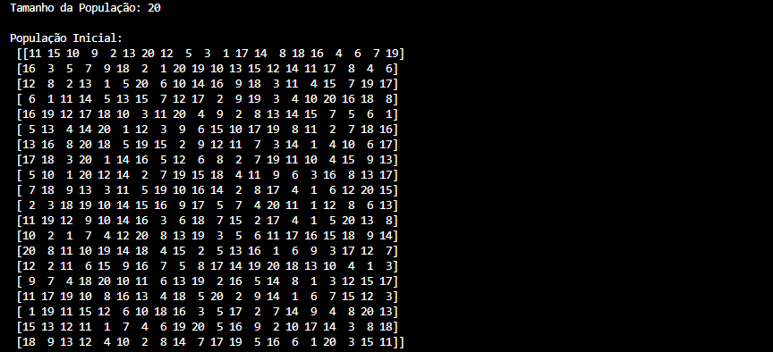
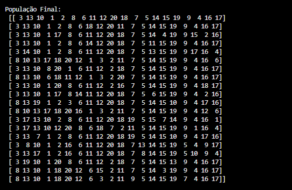
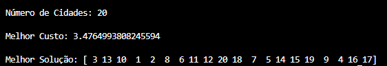

# Algoritmos Genéticos - Caixeiro Viajante

Neste trabalho foi implementado um algoritmo genético para resolver o problema do Caixeiro Viajante. O objetivo é encontrar uma rota que visite todas as cidades exatamente uma vez e minimize a distância total percorrida.

## Objetivo

O problema consiste em encontrar o menor caminho que passa por todas as cidades e retorna ao ponto de partida. As cidades são representadas por suas coordenadas em X e Y, que podem ser lidas a partir do arquivo `cidades.mat`.

## Dados utilizados

O arquivo `cidades.mat` contém as coordenadas das 20 cidades. Cada cidade possui uma posição (x, y) no plano. A distância entre duas cidades é calculada pela fórmula da distância euclidiana.

## Representação da solução

Cada indivíduo da população representa uma permutação das cidades, ou seja, uma ordem de visita. A função de aptidão calcula a soma das distâncias entre cidades consecutivas, sendo que a menor distância corresponde à melhor solução.

## Operadores do algoritmo genético

- Seleção por roleta
- Cruzamento do tipo cycle
- Mutação por troca de posições

A partir dessas operações, o algoritmo gera novas populações e busca melhorar a solução ao longo das gerações.

## Observação

O código apresenta a população inicial, a população final, o melhor custo e a melhor solução encontrada, além de exibir o melhor caminho em um gráfico. Abaixo estão exemplos de saída do algoritmo e da representação visual da rota.

